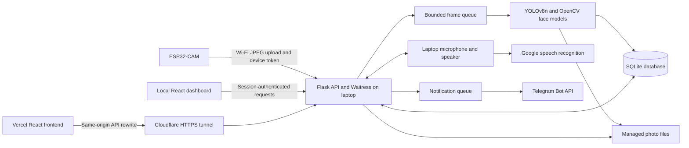
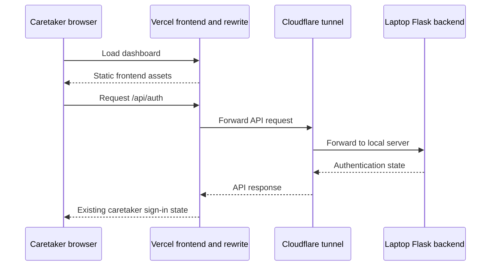

# SAHAYAK System Architecture

SAHAYAK is a personal memory and daily assistance prototype. An ESP32-CAM captures images, a laptop performs recognition and stores observations, and a React dashboard provides patient and caretaker views.

This document describes the implemented system. SAHAYAK supports one patient profile (`patient_001`) and one caretaker login per installation.

## System overview

The diagram shows logical components. Flask workers, inference, audio and storage run on the same laptop rather than separate cloud services.

## Components and responsibilities

| Component | Implementation | Responsibility |
| --- | --- | --- |
| Camera device | AI Thinker ESP32-CAM | Capture JPEG images and upload over 2.4 GHz Wi-Fi |
| Camera firmware | Arduino C++ | Device authentication, capture timing, configuration polling and reconnect handling |
| Camera setup page | ESP32 WebServer, DNSServer and Preferences/NVS | Change Wi-Fi and laptop server address without another firmware upload |
| HTTP server | Python Flask and Waitress | Authenticate requests and expose the application API |
| Vision worker | Ultralytics YOLOv8n, OpenCV YuNet and SFace | Detect supported objects and match reviewed familiar faces |
| Persistence | SQLite and local JPEG files | Save people, samples, sightings, routines, progress and help status |
| Dashboard | React, TypeScript, Vite, CSS and Framer Motion | Caretaker management and simplified patient interaction |
| Speech input | SpeechRecognition, PyAudio and Google speech service | Record the laptop microphone and transcribe questions |
| Speech output | Windows SAPI on Windows; pyttsx3 fallback elsewhere | Read answers through the laptop speaker |
| Notifications | Requests and Telegram Bot API | Deliver help alerts and selected evidence photos |
| Hosted access | Vercel and Cloudflare Quick Tunnel | Serve the frontend remotely while keeping the backend on the laptop |

## Camera-to-memory pipeline

1. The firmware captures a JPEG and posts it to `/upload` with the device token.
2. Flask validates the image, applies the configured camera rotation and updates the in-memory preview.
3. Flask places the frame into a queue with a maximum of three pending frames. A full queue returns HTTP `429`.
4. A background worker performs object detection and face recognition. During guided enrollment, it also attempts to collect a sample.
5. An observation containing objects or recognized people creates or updates a memory event.
6. Consecutive matching observations from the same device and room, less than 60 seconds apart, can merge into the latest unverified event. The event retains the latest photo and increments its frame count. Verified events remain separate from new observations.
7. A successfully processed frame with no objects and no recognized people is deleted from managed disk storage unless another record references it. Its latest live preview can remain in RAM.

Failed inference does not count as an empty detection. The system does not promise a camera-side outage buffer or uninterrupted recording.

## People enrollment and relationships

The caretaker creates a person with a name, relationship and optional introduction. Samples come from uploaded photos, a recent camera frame or guided capture.

Guided capture targets six distinct frames within two minutes. Each accepted sample must contain exactly one sufficiently large detected face. Samples begin as pending review. Only approved samples belonging to active people participate in recognition.

Relationships are profile data rather than model predictions. For example:

- `Who is my daughter?` uses the enrolled name, relationship and introduction.
- `Where is my daughter?` resolves the relationship to an enrolled person and searches past sightings.
- If multiple people share that relationship, a location query asks for a name.
- If nobody has that relationship, the system asks the caretaker to add it rather than inventing an answer.

See [MODELS.md](MODELS.md) for the face-matching pipeline and thresholds.

## Questions, schedules and help

The query service uses keyword and pattern matching plus structured database retrieval. It does not call a general-purpose LLM or use a vector database.

Supported paths include person introductions, last-recorded person/object sightings, daily schedules, next routine steps and caretaker-approved exact-question answers. Person and object filters must both match when supplied together.

A help query such as `Sahayak help` saves a help request, attempts to queue a Telegram notification and includes today's enabled schedule. A queued notification is not confirmed delivery, and successful Telegram delivery is not caretaker acknowledgement.

Routine progress uses explicit user actions. Schedule times and daily boundaries follow the laptop's local timezone. Configure the laptop timezone consistently for the intended patient location.

## Background execution

The application starts these workers when normal runtime mode is enabled:

| Worker | Behavior |
| --- | --- |
| Frame processor | Loads the vision models and consumes queued frames |
| Telegram notifier | Consumes a queue of up to 30 notifications, with up to three delivery attempts |
| Maintenance | Runs periodically to apply retention and remove old, unreferenced managed photos |
| Audio speaker | Processes queued speech jobs on a dedicated thread |

Frame and notification queues are in memory. Pending notifications from an earlier process are marked failed on restart instead of reporting unconfirmed delivery as successful. SQLite records and managed files persist across restarts.

## Data storage

Default runtime folder: `sahayak_cloud/data/`. `SAHAYAK_DATA` can select another data directory.

| Table | Main contents |
| --- | --- |
| `settings` | Installation settings, session key, password hash, device token and Telegram configuration |
| `people` | Enrolled identities, relationships and introductions |
| `samples` | Face embedding, image path and approval state |
| `events` | Observation times, people, objects, detections, location and evidence image path |
| `devices` | Last upload, frame count, latest image reference and error |
| `routines` | Scheduled time, steps and enabled state |
| `progress` | Routine step progress for each local day |
| `answers` | Caretaker-approved question/answer pairs and optional expiry |
| `help` | Assistance requests and acknowledgement state |
| `notifications` | Telegram queue/delivery status and sanitized error |

SQLite uses WAL mode. Photos are separate files under `data/images/`; they are not image blobs inside SQLite. Person deletion and memory deletion generally hide records rather than securely erasing historical data. Sample deletion removes the sample row, while file cleanup follows reference and age checks.

The default camera-event retention is 30 days. Maintenance hides expired camera events and removes unreferenced managed photos older than one hour. Original legacy photos outside managed storage remain unchanged. Back up the database and image folder together with the application stopped.

## Deployment modes

### Local installation

The ESP32 and laptop share a network. Waitress listens on port `5000`, serves the built dashboard and exposes the API. Vite development mode uses port `8080` and proxies API requests to port `5000`.

The laptop microphone and speaker are controlled through the local dashboard at `http://localhost:5000/`. The ESP32 does not provide audio input or output.

### Hosted frontend, laptop backend

`start-remote-sahayak.py` creates a temporary tunnel, updates the allowed frontend origins and redeploys the Vercel API rewrite. A new tunnel URL requires that update. Keep the launcher, laptop and internet connection available. See [deploy/README.md](deploy/README.md).

The hosted frontend does not contain the models, database or enrollment samples. Data viewed remotely still passes through Cloudflare and Vercel. Google speech recognition and Telegram also communicate with external services.

## Camera Wi-Fi provisioning

The first firmware installation uses a private `config.h` created from `firmware/config.example.h`. Subsequent setup-page changes persist in ESP32 NVS.

When station Wi-Fi is unavailable for 30 seconds, the firmware opens a password-protected `SAHAYAK-Setup-...` access point. The caretaker connects and opens `http://192.168.4.1/`, signs in as `caretaker` using the device-specific setup password, then enters the new network and laptop HTTP address.

The camera prints its unique setup password on USB Serial Monitor at 115200 baud. Saved Wi-Fi passwords and the device token do not appear in the page. Setup requests include a form nonce. The page accepts a private IPv4 server destination and pauses uploads briefly during setup activity. The page uses local HTTP and is intended for a trusted network.

## Access controls and boundaries

- The first caretaker password is created locally and must contain at least ten characters. A hash is stored rather than the plaintext password.
- Caretaker API requests use an HttpOnly, SameSite Strict session cookie with a 12-hour configured lifetime.
- Failed sign-in attempts are limited to eight per visitor within 60 seconds.
- Browser writes require a matching host or an explicitly configured allowed origin.
- Camera configuration always requires the device token. Uploads require it when legacy compatibility is disabled. Legacy uploads are allowed by default for migration, so disable compatibility after provisioning the updated firmware.
- A tunneled visitor is not considered local merely because the tunnel reaches Flask over loopback. Laptop audio endpoints reject remote visitors.
- Tokens and settings in SQLite rely on operating-system file access rather than application-level encryption. This is a prototype with one caretaker role, not a multi-tenant service or a clinical system.

## Implementation map

- `firmware/SahayakCamera/SahayakCamera.ino`: capture, upload and configuration polling
- `firmware/SahayakCamera/WifiSetup.h`: Wi-Fi setup and recovery
- `sahayak_cloud/server.py`: Waitress launcher
- `sahayak_cloud/app.py`: API, query routing and workers
- `sahayak_cloud/vision.py`: active object and face inference
- `sahayak_cloud/store.py`: schema and persistence
- `sahayak_cloud/audio.py`: laptop audio
- `Web Interface/src/`: dashboard source
- `tests/test_workflows.py`: workflow regression tests

`face_recognizer.py`, `object_detect.py` and `episodic_memory.py` are earlier prototype modules. The current server uses `vision.py`, `store.py` and the query logic in `app.py`.

## Current limits

Sightings describe past observations, not guaranteed current positions. Room labels are configured or caretaker-entered rather than GPS or inferred wearable location. Generic object detection cannot prove ownership or distinguish identical phones. Face matching depends on reviewed samples and image quality. The application cannot infer medication ingestion from camera images. Software tests do not establish clinical benefit.

Related documentation: [Model pipeline](MODELS.md), [API reference](API.md), [Setup guide](README.md).
